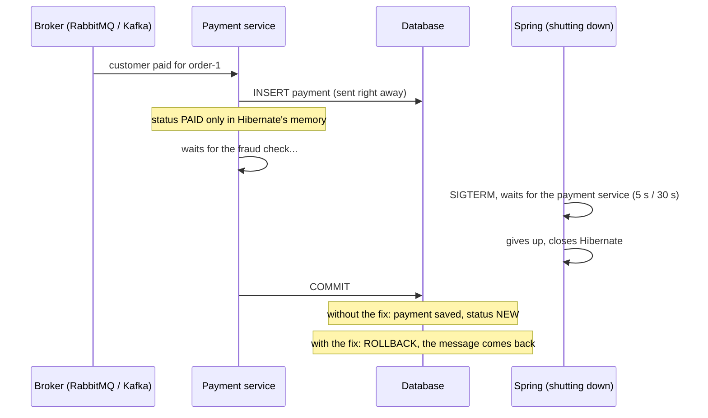

# hibernate-partial-commit-on-shutdown

Stopping an application at the wrong moment can save **half of a transaction** to the database, with no error in the
logs. This repo shows it on a simple shop application (Spring Boot 4, Hibernate 7, Postgres): on RabbitMQ and Kafka
messages, on an HTTP request, on a `@Scheduled` job and on an `@Async` task. Then it shows a fix.

Every scenario is ordinary Spring code, tested against real Postgres, Kafka and RabbitMQ in Docker:

| Scenario                                                                                                                                                                                              | Test                                                                                        | Without fix                                                                                          | With fix                                                                             |
|-------------------------------------------------------------------------------------------------------------------------------------------------------------------------------------------------------|---------------------------------------------------------------------------------------------|------------------------------------------------------------------------------------------------------|--------------------------------------------------------------------------------------|
| [Kafka] A plain `@KafkaListener` calls a `@Transactional` service that saves the payment, marks the order as paid and calls an external API. The pod is stopped while the service waits for that API. | [`KafkaPaymentShutdownTest`](src/test/java/shop/KafkaPaymentShutdownTest.java)              | ❌ Payment saved but the order is still `NEW`, and the app reports success with no error in the logs. | ✅ The whole transaction is rolled back, and a new pod processes the message in full. |
| [RabbitMQ] The same service, called from a plain `@RabbitListener`. The pod is stopped at the same moment.                                                                                            | [`RabbitMqPaymentShutdownTest`](src/test/java/shop/RabbitMqPaymentShutdownTest.java)        | ❌ Payment saved but the order is still `NEW`, and the message counts as processed.                   | ✅ Rolled back; the message returns to the queue and a new pod processes it in full.  |
| [HTTP] A plain `@RestController` endpoint calls the same service. The pod is stopped while the request is in progress.                                                                                | [`HttpRequestShutdownTest`](src/test/java/shop/HttpRequestShutdownTest.java)                | ❌ Payment saved but the order is still `NEW`, and the caller gets no response at all.                | ✅ Rolled back and nothing saved, so the caller can safely retry.                     |
| [@Async] A webhook answers `202` and calls the same service from an `@Async` method. The pod is stopped while the task runs.                                                                          | [`AsyncTaskShutdownTest`](src/test/java/shop/AsyncTaskShutdownTest.java)                    | ❌ Payment saved but the order is still `NEW`, while the provider already got `202`.                  | ✅ Nothing saved halfway, but the provider already got `202` and won't resend.        |
| [@Scheduled] A `@Scheduled` job calls the same service for each new bank transfer. The pod is stopped while the job runs.                                                                             | [`ScheduledJobShutdownTest`](src/test/java/shop/ScheduledJobShutdownTest.java)              | ❌ Payment saved but the order is still `NEW`, with no error in the logs.                             | ✅ Rolled back and nothing saved.                                                     |
| [Proof from Postgres] The Kafka and RabbitMQ scenarios, checked in Postgres itself (statement log and `xmin`) instead of through the application.                                                     | `databaseProof_…` in [`PaymentShutdownStory`](src/test/java/shop/PaymentShutdownStory.java) | ❌ Postgres received the payment `INSERT` and a `COMMIT`, but never the order `UPDATE`.               | ✅ Postgres received `ROLLBACK` instead of `COMMIT`, and the payment isn't there.     |

## The story

The shop receives the message **"customer paid for the order"**. The payment service does three things in one
transaction:

1. saves the payment,
2. changes the order status to `PAID`,
3. calls an external fraud-check system (which is slow today).

During step 3 Kubernetes stops the pod (SIGTERM). Spring waits a while for the payment service, eventually gives up
and shuts down the rest of the application, including Hibernate. Then the fraud check answers and the payment service
finishes its transaction.

**Without the fix** the database has the payment, but the order is still `NEW`. The application thinks everything went
fine, the message is acknowledged, and there is no error in the logs.

**With the fix** nothing is saved, the application knows it failed, the message comes back, and a new pod processes it
in full: the payment is there and the order is `PAID`.



## Why it happens

Hibernate keeps changes in memory, like a **scratchpad**, and writes them to the database only at the end of the
transaction.

- The payment's id is assigned by the database, so Hibernate has to write the payment right away. That part is
  already in the database, though not committed yet.
- The order status change waits in the scratchpad.

If Hibernate has already been closed when the transaction ends, it **silently skips writing out the scratchpad**, but
still tells the database to commit. The database commits what it received: the payment alone.

When Spring stops waiting for the payment service:

| Broker   | How long Spring waits | What happens next                                                          |
|----------|-----------------------|----------------------------------------------------------------------------|
| RabbitMQ | 5 s                   | it interrupts the thread, but waiting for an HTTP response does not notice |
| Kafka    | 30 s                  | it moves on; the payment service's thread keeps working                    |

Between closing Hibernate and closing the database connection pool there is a window in which the transaction gets
committed halfway. In this application it is 0.5 s: the time `MetricsExporter` needs to send its remaining metrics on
shutdown. Real applications usually have several such components.

The window ends when the connection pool shuts down: HikariCP then aborts even the connections that are still in use,
so a later commit fails with an error instead of saving half of the data.

## Not only message listeners

The same thing happens to any thread that is still working when Spring gives up waiting for it. The shop has three
more ways in which a payment gets recorded, all through the same `PaymentService`, and
[`EntryPointShutdownStory`](src/test/java/shop/EntryPointShutdownStory.java) runs the same story on each of them:

| Entry point      | In the shop                                                                                       | How long Spring waits                     | What the sender saw                            |
|------------------|---------------------------------------------------------------------------------------------------|-------------------------------------------|------------------------------------------------|
| HTTP request     | an employee records a payment in the admin panel                                                  | 30 s: graceful shutdown of the web server | no answer: the connection was closed           |
| `@Async` task    | the payment provider's webhook answers `202` right away and records the payment in the background | 30 s: `applicationTaskExecutor`           | `202 Accepted`: the notification was delivered |
| `@Scheduled` job | every minute the shop asks the bank for new transfers and records each payment                    | 30 s: `taskScheduler`                     | nothing: the bank only listed the transfer     |

Without the fix, all three end the way the broker stories do: the payment is saved, the order is still `NEW`, the
application thinks the transaction was committed, and there is no error in the logs. The only trace is in the HTTP
case: a Tomcat warning that "some application threads may still be running".

What the sender saw makes it worse:

- **HTTP**: the shop saved half of the payment, yet the employee's browser shows an error, which invites them to try
  again.
- **`@Async`**: with the fix nothing is saved halfway, but nothing is saved at all either, and the payment provider
  already got `202`, so it will not send the notification again. The fix keeps the data consistent; it cannot bring
  back work that existed only in the pod's memory.

## Hard evidence from the database

Could the missing status change be caused by the isolation level, or by how the test reads the database? The two
`databaseProof_...` tests ask Postgres itself, bypassing the application:

1. **The Postgres statement log**: what actually reached the database from the payment service in its transaction.
2. **The transaction number stored in each row** (`xmin`). In every row Postgres stores the number of the transaction
   that created the row's current version. If the payment service had changed the order status, the order row would
   carry the payment service's transaction number.

Without the fix:

```
STEP 9: Postgres log: everything it received from the payment service in this transaction:
        BEGIN
        insert into payments (amount,order_id) values ($1,$2)   <- saves the payment
        select o1_0.id,o1_0.status from orders o1_0 where o1_0.id=$1   <- reads the order
        COMMIT   <- commit
STEP 10: Postgres about the order: it was last changed by transaction no. 738, the one in which the test created the order (no. 738)
STEP 11: Postgres about the payment: it was saved by transaction no. 739, the payment service's transaction (no. 739, ended with: COMMIT)
STEP 12: CONCLUSION: the status change never reached the database, and the database committed the rest of the transaction.
```

With the fix:

```
STEP 9: Postgres log: everything it received from the payment service in this transaction:
        BEGIN
        insert into payments (amount,order_id) values ($1,$2)   <- saves the payment
        select o1_0.id,o1_0.status from orders o1_0 where o1_0.id=$1   <- reads the order
        ROLLBACK   <- rollback
STEP 10: Postgres about the order: it was last changed by transaction no. 734, the one in which the test created the order (no. 734)
STEP 11: Postgres about the payment: it is not in the database
STEP 12: CONCLUSION: the database rolled back the whole transaction. Nothing was saved halfway.
```

The statement that changes the status (`update orders`) never reached the database at all. Hibernate did not send it,
because it had already been closed, and yet it sent `COMMIT`.

## The fix

[`PartialCommitGuard`](src/main/java/fix/PartialCommitGuard.java) is a single configuration you add to the
application. At the start of every transaction it leaves a "guard" in it. Hibernate asks the guard right before
committing, after it has written out the scratchpad. If Hibernate is closed at that point, the guard refuses and
Hibernate rolls the whole transaction back. **Either everything is saved, or nothing.** In normal operation the guard
changes nothing.

## The application and the test

The shop is an ordinary Spring Boot application in one module. It talks to Kafka or to RabbitMQ depending on its
profile, so there are two kinds of pods: `--spring.profiles.active=kafka` and `--spring.profiles.active=rabbitmq`. It
knows nothing about tests: it gets the addresses of the database and the broker the way a production pod does.

The test starts Postgres and the broker in Docker (Testcontainers), and then starts pods through the application's own
`main`, with the same kind of arguments a production pod gets:

```
--spring.profiles.active=kafka
--spring.kafka.bootstrap-servers=localhost:55001
--spring.datasource.url=jdbc:postgresql://localhost:55002/test
```

To each pod the test adds only its stand-ins for the external systems (the fraud check and the bank, so it can decide
when they answer) and a recorder of how transactions ended. A test with the fix also adds `PartialCommitGuard`. The
pods without a broker profile get only the database address, and every pod runs its web server on a free port
(`--server.port=0`).

The story needs to stop one pod in the middle of a transaction and then start a new one, so the test starts the pods
itself instead of letting `@SpringBootTest` start one application for it.

## Where to find what

| File                                                                                                                                                                                                                                   | What it is                                                                                      |
|----------------------------------------------------------------------------------------------------------------------------------------------------------------------------------------------------------------------------------------|-------------------------------------------------------------------------------------------------|
| [`PaymentService`](src/main/java/shop/payment/PaymentService.java)                                                                                                                                                                     | records the payment: ordinary, everyday code                                                    |
| [`KafkaPaymentListener`](src/main/java/shop/messaging/KafkaPaymentListener.java), [`RabbitMqPaymentListener`](src/main/java/shop/messaging/RabbitMqPaymentListener.java)                                                               | receive the payment message; each one is active only in its broker's profile                    |
| [`AdminPaymentController`](src/main/java/shop/web/AdminPaymentController.java)                                                                                                                                                         | the admin panel: an HTTP request that records a payment                                         |
| [`PaymentProviderWebhook`](src/main/java/shop/web/PaymentProviderWebhook.java), [`BackgroundPayments`](src/main/java/shop/payment/BackgroundPayments.java)                                                                             | the payment provider's webhook, which records the payment in an `@Async` task                   |
| [`BankTransferImport`](src/main/java/shop/bank/BankTransferImport.java)                                                                                                                                                                | the `@Scheduled` job that imports bank transfers                                                |
| [`MetricsExporter`](src/main/java/shop/infra/MetricsExporter.java)                                                                                                                                                                     | a component that takes 0.5 s to shut down                                                       |
| [`PartialCommitGuard`](src/main/java/fix/PartialCommitGuard.java)                                                                                                                                                                      | the fix                                                                                         |
| [`PaymentShutdownStory`](src/test/java/shop/PaymentShutdownStory.java)                                                                                                                                                                 | **the test stories, without and with the fix** (start here), plus the two database-proof tests  |
| [`KafkaPaymentShutdownTest`](src/test/java/shop/KafkaPaymentShutdownTest.java), [`RabbitMqPaymentShutdownTest`](src/test/java/shop/RabbitMqPaymentShutdownTest.java)                                                                   | the same stories on each broker: which broker to start and how to send the message              |
| [`EntryPointShutdownStory`](src/test/java/shop/EntryPointShutdownStory.java)                                                                                                                                                           | the same story without a broker, without and with the fix                                       |
| [`HttpRequestShutdownTest`](src/test/java/shop/HttpRequestShutdownTest.java), [`AsyncTaskShutdownTest`](src/test/java/shop/AsyncTaskShutdownTest.java), [`ScheduledJobShutdownTest`](src/test/java/shop/ScheduledJobShutdownTest.java) | the story on each of those entry points: how the payment arrives and what the sender saw        |
| [`SlowFraudCheck`](src/test/java/shop/SlowFraudCheck.java), [`FakeBank`](src/test/java/shop/FakeBank.java)                                                                                                                             | the test's stand-ins for the fraud-check system and the bank; the test decides when they answer |

## Running it

Requires Docker (e.g. OrbStack) and Java 21+. In the IDE just run any of the `...ShutdownTest` classes. From the
terminal:

```bash
mvn -B test -Dtest=RabbitMqPaymentShutdownTest
```

```bash
mvn -B test -Dtest=KafkaPaymentShutdownTest
```

```bash
mvn -B test -Dtest='HttpRequestShutdownTest,AsyncTaskShutdownTest,ScheduledJobShutdownTest'
```

Most cases take about 30 s each, because that is how long Spring waits before it gives up.

The console tells the story step by step (RabbitMQ, without the fix):

```
STEP 1: Starting a shop pod WITHOUT THE FIX
The following 1 profile is active: "rabbitmq"
Started ShopApplication
STEP 2: The database has order order-5024f4ac: payments: 0, order status: NEW
STEP 3: The customer pays: sending the payment message for order-5024f4ac (the fraud check is slow today)
[payments] saved the payment for order-5024f4ac (the INSERT already went to the database, not committed yet)
[payments] marked order order-5024f4ac as PAID (for now only in Hibernate's memory)
[payments] calling the fraud check...
STEP 4: Kubernetes stops the pod (SIGTERM) while the payment service is in the middle of its transaction
STEP 5: Spring waits for the payment service: with RabbitMQ 5 s (shutdownTimeout); then it interrupts the thread, but waiting for an HTTP response does not notice
Closing JPA EntityManagerFactory for persistence unit 'default'
[metrics] sending the remaining metrics before shutdown (0.5 s)
STEP 6: Spring stopped waiting and closed Hibernate. The payment service is still waiting for the fraud check
STEP 7: The fraud check finally answers, the payment service finishes its transaction
[payments] the fraud check answered, finishing the transaction (commit)
STEP 8: The pod has stopped
STEP 9: According to the application: the transaction was committed
STEP 10: In the database: payments: 1, order status: NEW
STEP 11: RESULT: payment saved, order unpaid. The data is inconsistent and there is no error in the logs.
```

## What the test simplifies

- The only thing the test controls is when the fraud check answers: right after Spring closes Hibernate. In real life,
  hitting that window is a matter of chance.
- Spring, Hibernate, the connection pool and the listener containers run without any changes.

## For the curious

The first commit in this repo's history (`f6a43bf`, in Polish) contains the technical version:

- a sweep of the time window in 100 ms steps (when the result is full, partial, or rolled back);
- a description of the same results on Spring Boot 3.5 / Hibernate 6.6.
