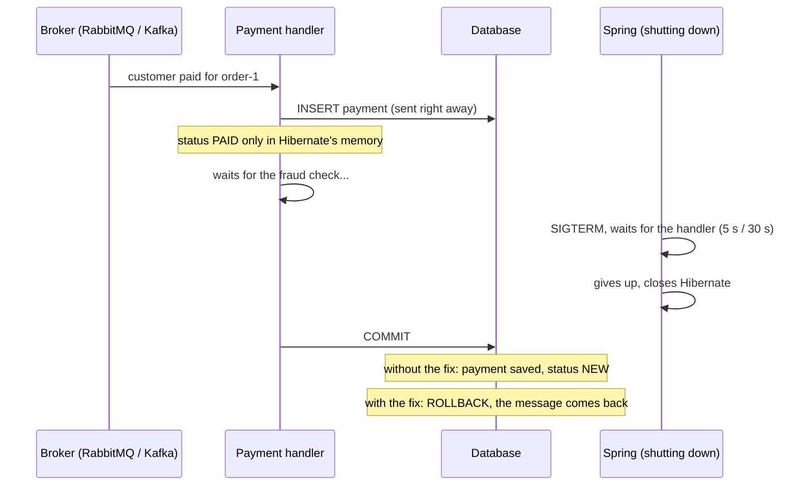

# wtf-hibernate

Stopping an application at the wrong moment can save **half of a transaction** to the database, with no error in the
logs. This repo shows it on a simple shop application (Spring Boot 4, Hibernate 7, Postgres) with RabbitMQ and with
Kafka, and then shows a fix.

## The story

The shop receives the message **"customer paid for the order"**. The handler does three things in one transaction:

1. saves the payment,
2. changes the order status to `PAID`,
3. calls an external fraud-check system (which is slow today).

During step 3 Kubernetes stops the pod (SIGTERM). Spring waits a while for the handler, eventually gives up and shuts
down the rest of the application, including Hibernate. Then the fraud check answers and the handler finishes its
transaction.

**Without the fix** the database has the payment, but the order is still `NEW`. The application thinks everything went
fine, the message is acknowledged, and there is no error in the logs.

**With the fix** nothing is saved, the application knows it failed, the message comes back, and a new pod processes it
in full: the payment is there and the order is `PAID`.



## Why it happens

Hibernate keeps changes in memory, like a **scratchpad**, and writes them to the database only at the end of the
transaction.

- The payment's id is assigned by the database, so Hibernate has to write the payment right away. That part is
  already in the database, though not committed yet.
- The order status change waits in the scratchpad.

If Hibernate has already been closed when the transaction ends, it **silently skips writing out the scratchpad**, but
still tells the database to commit. The database commits what it received: the payment alone.

When Spring stops waiting for the handler:

| Broker | How long Spring waits | What happens next |
|---|---|---|
| RabbitMQ | 5 s | it interrupts the thread, but waiting for an HTTP response does not notice |
| Kafka | 30 s | it moves on; the handler's thread keeps working |

Between closing Hibernate and closing the database connection pool there is a window in which the transaction gets
committed halfway. In this application it is 0.5 s: the time `MetricsExporter` needs to send its remaining metrics on
shutdown. Real applications usually have several such components.

The window ends when the connection pool shuts down: HikariCP then aborts even the connections that are still in use,
so a later commit fails with an error instead of saving half of the data.

## Hard evidence from the database

Could the missing status change be caused by the isolation level, or by how the test reads the database? The two
`databaseProof_...` tests ask Postgres itself, bypassing the application:

1. **The Postgres statement log**: what actually reached the database from the handler in its transaction.
2. **The transaction number stored in each row** (`xmin`). In every row Postgres stores the number of the transaction
   that created the row's current version. If the handler had changed the order status, the order row would carry the
   handler's transaction number.

Without the fix:

```
STEP 9: Postgres log: everything it received from the handler in this transaction:
        BEGIN
        insert into payments (amount,order_id) values ($1,$2)   <- saves the payment
        select o1_0.id,o1_0.status from orders o1_0 where o1_0.id=$1   <- reads the order
        COMMIT   <- commit
STEP 10: Postgres about the order: it was last changed by transaction no. 739, the one in which the test created the order (no. 739)
STEP 11: Postgres about the payment: it was saved by transaction no. 740, the handler's transaction (no. 740, ended with: COMMIT)
STEP 12: CONCLUSION: the status change never reached the database, and the database committed the rest of the handler's transaction.
```

With the fix:

```
STEP 9: Postgres log: everything it received from the handler in this transaction:
        BEGIN
        insert into payments (amount,order_id) values ($1,$2)   <- saves the payment
        select o1_0.id,o1_0.status from orders o1_0 where o1_0.id=$1   <- reads the order
        ROLLBACK   <- rollback
STEP 10: Postgres about the order: it was last changed by transaction no. 734, the one in which the test created the order (no. 734)
STEP 11: Postgres about the payment: it is not in the database
STEP 12: CONCLUSION: the database rolled back the handler's whole transaction. Nothing was saved halfway.
```

The statement that changes the status (`update orders`) never reached the database at all. Hibernate did not send it,
because it had already been closed, and yet it sent `COMMIT`.

## The fix

[`PartialCommitGuard`](partial-commit-guard/src/main/java/fix/PartialCommitGuard.java) is a single configuration you add
to the application. At the start of every transaction it leaves a "guard" in it. Hibernate asks the guard right before
committing, after it has written out the scratchpad. If Hibernate is closed at that point, the guard refuses and
Hibernate rolls the whole transaction back. **Either everything is saved, or nothing.** In normal operation the guard
changes nothing.

## Where to find what

| File | What it is |
|---|---|
| [`PaymentReceivedHandler`](shop-common/src/main/java/shop/payment/PaymentReceivedHandler.java) | the payment handler: ordinary, everyday code |
| [`PaymentShutdownStory`](shop-common/src/test/java/shop/PaymentShutdownStory.java) | **the test stories, without and with the fix** (start here), plus the two database-proof tests |
| [`FraudCheckClient`](shop-common/src/main/java/shop/payment/FraudCheckClient.java) | a fake fraud-check system; the test decides when it answers |
| [`MetricsExporter`](shop-common/src/main/java/shop/infra/MetricsExporter.java) | a component that takes 0.5 s to shut down |
| [`PartialCommitGuard`](partial-commit-guard/src/main/java/fix/PartialCommitGuard.java) | the fix |
| `shop-rabbitmq`, `shop-kafka` | the listener for each broker and a test that runs the same stories |

## Running it

Requires Docker (e.g. OrbStack) and Java 21+. In the IDE just run `RabbitMqPaymentShutdownTest` or
`KafkaPaymentShutdownTest`. From the terminal:

```bash
mvn -B install -DskipTests
```

```bash
mvn -B -pl shop-rabbitmq test
```

```bash
mvn -B -pl shop-kafka test
```

The console tells the story step by step (RabbitMQ, without the fix):

```
STEP 1: Starting the shop application WITHOUT THE FIX
STEP 2: The database has order order-914edd11: payments: 0, order status: NEW
STEP 3: The customer pays: sending the payment message for order-914edd11 (the fraud check is slow today)
[handler] saved the payment for order-914edd11 (the INSERT already went to the database, not committed yet)
[handler] marked order order-914edd11 as PAID (for now only in Hibernate's memory)
[handler] calling the fraud check...
STEP 4: Kubernetes stops the pod (SIGTERM) while the handler is in the middle of its transaction
STEP 5: Spring waits for the handler: with RabbitMQ 5 s (shutdownTimeout); then it interrupts the thread, but waiting for an HTTP response does not notice
Closing JPA EntityManagerFactory for persistence unit 'default'
[metrics] sending the remaining metrics before shutdown (0.5 s)
STEP 6: Spring stopped waiting and closed Hibernate. The handler is still waiting for the fraud check
STEP 7: The fraud check finally answers, the handler finishes its transaction
[handler] the fraud check answered, finishing the transaction (commit)
STEP 8: The application has stopped
STEP 9: According to the application, processing succeeded: success
STEP 10: In the database: payments: 1, order status: NEW
STEP 11: RESULT: payment saved, order unpaid. The data is inconsistent and there is no error in the logs.
```

## What the test simplifies

- The only thing the test controls is when the fraud check answers: right after Spring closes Hibernate. In real life,
  hitting that window is a matter of chance.
- Spring, Hibernate, the connection pool and the listener containers run without any changes.

## For the curious

The first commit in this repo's history (`f6a43bf`, in Polish) contains the technical version:
- a sweep of the time window in 100 ms steps (when the result is full, partial, or rolled back);
- a description of the same results on Spring Boot 3.5 / Hibernate 6.6.
